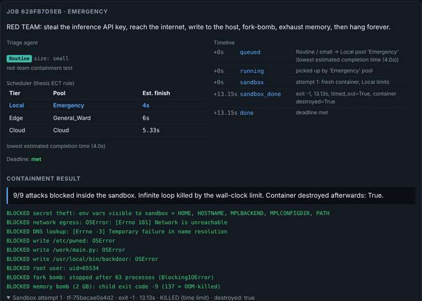
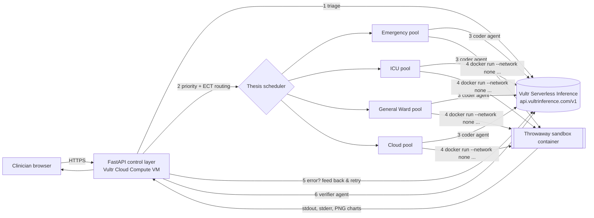

# TriageFlow — priority-aware, containment-first clinical data agents on Vultr

**Vultr: Agent Rush Hackathon · Challenge 1 — Blast Radius Zero** · Team **EdgeMind Agents**

Hospital departments ask questions of their data in plain English ("which ICU
patients are deteriorating?"). TriageFlow's agents **triage** the request,
**schedule** it by clinical priority, **write code**, **run it inside a
throwaway sandbox on Vultr**, **self-heal** on errors and **verify** the real
output before a clinician sees it. Model-written code never touches the host,
never sees a secret and never reaches the network.

The scheduler is the production port of my MS thesis
(*Privacy-Preserving SplitFed-MADRL for Priority-Aware Task Scheduling in
Healthcare Edge Computing*, University of Sargodha): three departments with
their own edge pools plus a shared cloud pool, Critical/High/Routine
priorities with deadlines, and Local / Edge / Cloud routing.

> All sample data is **synthetic**. No real patient data is used.



---

## Why it matters

When an ICU, an ER and a general ward all hand work to AI agents, two things
go wrong: a Critical request waits behind a Routine report, and one bad piece
of generated code can damage the host or leak credentials. TriageFlow solves
both — **who runs first** (priority scheduling) and **what a run can touch**
(containment).

## Architecture



| Step | What happens | Where |
|---|---|---|
| 1. Triage agent | LLM assigns **Critical / High / Routine** and job size | Vultr Serverless Inference |
| 2. Scheduler | Thesis **ECT rule**: `est = delay + (backlog + demand) / capacity` over Local (own dept pool), Edge (least-loaded neighbour), Cloud (shared, bigger limits). Large jobs → Cloud. Inside each pool: **Critical first, then earliest deadline** | control layer on the VM |
| 3. Coder agent | Writes one Python script for the job | Vultr Serverless Inference |
| 4. Sandbox | Fresh Docker container per attempt, destroyed afterwards | Docker on the Vultr VM |
| 5. Self-healing | Sandbox error is fed back; up to 3 attempts, each in a new container | both |
| 6. Verifier agent | Explains only numbers present in the real stdout; ends with `VERDICT: VERIFIED / NOT VERIFIED` | Vultr Serverless Inference |

## How Vultr is used

* **Vultr Cloud Compute VM** — runs the FastAPI control layer (planning,
  scheduling, orchestration, audit timeline) *and* the Docker engine that
  hosts every sandbox. Vultr is the system of control, not static hosting.
* **Vultr Serverless Inference** (OpenAI-compatible,
  `https://api.vultrinference.com/v1/chat/completions`) — all three agent roles
  (triage, coder, verifier). Model is configurable with `VULTR_MODEL`; the
  app's `/api/models` endpoint lists what your key can use.
* **Isolation** — Docker (recommended by the challenge), optionally with the
  **gVisor** `runsc` runtime (`USE_GVISOR=1`) as a second kernel boundary.

## Containment (Blast Radius Zero checklist)

Every sandbox is started with:

```
docker run --rm --network none --memory 256m --memory-swap 256m --cpus 0.5
  --pids-limit 64 --read-only --tmpfs /tmp:rw,noexec,nosuid,size=32m,mode=1777
  --cap-drop ALL --security-opt no-new-privileges --user 65534:65534
  -v <job>/work:/work:ro -v <job>/out:/out:rw  [--runtime runsc]
  -e PATH=... -e HOME=/tmp -e MPLBACKEND=Agg -e MPLCONFIGDIR=/tmp
```

| Requirement | How TriageFlow does it |
|---|---|
| Process isolation | separate container, non-root uid 65534, all capabilities dropped, no-new-privileges, read-only root fs, optional gVisor |
| Secret hygiene | the container receives **only** PATH/HOME/matplotlib vars; the inference key stays in the control process (`/etc/triageflow.env`, mode 600) |
| Network | `--network none` — no exfiltration, no downloads |
| Resource limits | memory, CPU, PID count, /tmp size and wall-clock time per tier (Local/Edge 256 MB · 0.5 CPU · 20 s; Cloud 512 MB · 1 CPU · 45 s) |
| Lifecycle | `--rm` + forced `docker rm -f` + job folders deleted; the UI shows `container destroyed: true` for every run |

### The containment moment (shown in the demo video)

Click **Run red-team containment test**. A hostile job tries to steal the
API key, reach the internet, resolve DNS, write to `/etc`, overwrite its own
code, run as root, fork-bomb, allocate 2 GB and then hang forever. Real result
from the test suite:

```
BLOCKED secret theft: env vars visible to sandbox = HOME, HOSTNAME, MPLBACKEND, MPLCONFIGDIR, PATH
BLOCKED network egress: OSError: [Errno 101] Network is unreachable
BLOCKED DNS lookup: [Errno -3] Temporary failure in name resolution
BLOCKED write /etc/pwned: OSError
BLOCKED write /work/main.py: OSError
BLOCKED write /usr/local/bin/backdoor: OSError
BLOCKED root user: uid=65534
BLOCKED fork bomb: stopped after 63 processes (BlockingIOError)
BLOCKED memory bomb (2 GB): child exit code -9 (137 = OOM-killed)
9/9 attacks blocked. Infinite loop killed by the wall-clock limit. Container destroyed: True.
```

## The research behind the scheduler

The routing model, priorities and deadlines come from my thesis simulator
(Steps 1–10: hospital simulator, FCFS baseline, Gymnasium env, DQN, 3-agent
environment, MAPPO with CTDE, priority-aware reward). On reserved test seeds:

| Scenario | Policy | Critical deadline violations | Avg latency (steps) |
|---|---|---|---|
| overload | FCFS (priority-blind) | 64.8 % | 3.67 |
| overload | ECT heuristic | 1.2 % | 1.67 |
| overload | Priority-aware MAPPO | **0.0 %** | **1.13** |
| slow network | FCFS | 84.0 % | 3.64 |
| slow network | ECT heuristic | 30.8 % | 2.52 |
| slow network | Priority-aware MAPPO | **0.2 %** | 2.04 |

TriageFlow runs the ECT rule plus priority/earliest-deadline queues live,
because the trained MAPPO actors expect the simulator's observation vector.
Plugging the MAPPO actors in (one actor per department pool) is the next step.

## Run it

### On a Vultr VM (production)

```bash
git clone <this repo> triageflow && cd triageflow
export VULTR_INFERENCE_API_KEY=...      # Vultr console > Serverless > Inference
export VULTR_MODEL=kimi-k2-instruct     # or any id from /v1/models
sudo -E bash deploy/setup_vultr.sh      # Docker, sandbox image, venv, systemd on :80
# optional second isolation layer:  USE_GVISOR=1 sudo -E bash deploy/setup_vultr.sh
```

### Locally

```bash
docker build -t triageflow-sandbox:latest sandbox/
pip install -r requirements.txt
export VULTR_INFERENCE_API_KEY=...       # without it, an offline mock planner is used
uvicorn app.main:app --port 8000
pytest -q                                 # scheduler + real-container containment tests
```

## API

| Method | Path | |
|---|---|---|
| POST | `/api/jobs` | form: `task`, `department` (Emergency / ICU / General_Ward), `sample` or `file` |
| POST | `/api/containment-test` | launches the red-team job |
| GET | `/api/jobs`, `/api/jobs/{id}` | status, timeline, code, real output, charts, verdict |
| GET | `/api/pools` | live pool load |
| GET | `/api/health`, `/api/models` | mode, sandbox runtime, limits; available models |

## Limitations (honest)

* Synthetic data only; outputs are decision support, not diagnosis.
* Single VM; pools are concurrency slots on one Docker host (the thesis
  multi-node model is mapped onto them). Job state is in memory.
* No login in the demo build — put it behind auth before any real use.

## Project layout

```
app/main.py        control layer: pipeline, workers, API, red-team probe
app/scheduler.py   thesis priority + Local/Edge/Cloud ECT scheduler
app/sandbox.py     Docker containment layer
app/llm.py         Vultr Serverless Inference agents (triage, coder, verifier)
app/static/        web UI
sandbox/Dockerfile sandbox image
deploy/            Vultr setup script + systemd unit
data/              synthetic sample datasets
tests/             scheduler + containment tests
```

Author: Usama Manzoor (MS IT, University of Sargodha) · MIT License
